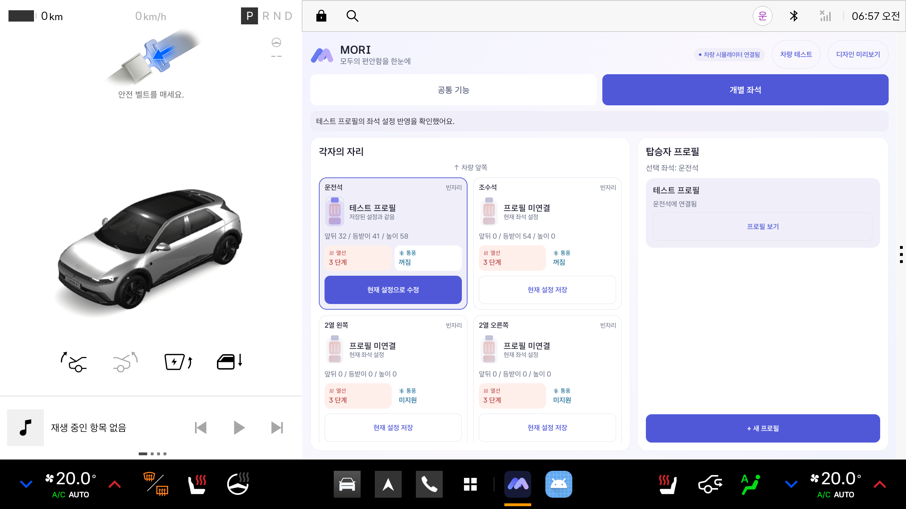
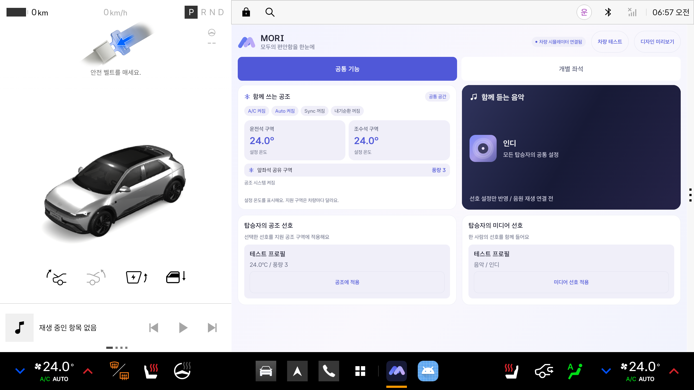

# MORI

음성으로 동승자와 좌석을 알려주면, 저장된 선호와 이번 이동의 요청을 조율해 공조와 함께 들을 음악을 준비하는 Pleos 기반 카 컨시어지 졸업 프로젝트입니다.

## 현재 구현 상태

- **개별 좌석**: 4개 좌석의 자세, 열선/통풍과 연결된 프로필 표시
- **프로필 관리**: 오른쪽 패널에서 생성, 수정, 삭제와 좌석 연결. 현재 좌석 설정으로 생성하거나 기존 프로필 업데이트
- **공통 기능**: 현재 공조와 미디어 선호를 분리하고, 프로필별 선호를 아래 목록에서 선택
- **실시간 연결**: Vehicle SDK 상태 조회와 공식 에뮬레이터의 시트/공조 제어
- **큰 조작 영역**: 88dp 탭, 80dp 이상 주요 버튼. 작은 화면에서 세로 배치와 스크롤 제공
- **주야간 팔레트**: OS 테마에 따라 전환. 디자인 미리보기에서 저장과 적용 제한

프로필은 앱 내부 저장소에 저장하며 자동으로 사람을 식별하지 않습니다. 좌석 연결은 이번 앱 실행 동안 유지합니다. 적용은 개발용 Pleos 에뮬레이터에서 검증했습니다. 실제 차량용 제어 권한과 연동은 후속 범위입니다. 음성 대화와 음원 재생도 다음 단계이며, 현재 미디어는 선호 선택까지만 반영합니다.

화면과 사용법: [프로필 대시보드 안내](docs/PROFILE_DASHBOARD.md)





위 검증 화면의 ‘테스트 프로필’은 통합 검사에서 임시로 만든 예시이며 기본 프로필로 등록되지 않습니다.

## 처음 실행하기

1. Android Studio를 실행하고 **Open**을 선택합니다.
2. 이 저장소 안의 **android 폴더**를 엽니다.
3. Gradle JDK를 **Java 17**로 선택하고 초기 동기화가 끝날 때까지 기다립니다.
4. Device Manager에서 **Pleos Connect v2.1.0**을 켭니다.
5. 실행 대상에 Pleos를 선택하고 위쪽의 **▶ Run**을 누릅니다.
6. **개별 좌석**에서 현재 설정을 저장하거나 프로필을 불러옵니다. **공통 기능**에서 공조와 미디어 선호를 선택합니다. **디자인 미리보기**는 차량 설정을 변경하지 않습니다.

컴퓨터에서 사용할 폴더: `/Users/saeuncheon/Desktop/26-2 CCP II/MORI/android`

상세 안내: [개발 시작하기](docs/GETTING_STARTED.md), [초기 검증 결과](docs/VALIDATION.md)

## 폴더 구성

```text
android/     Kotlin 차량 앱. Android Studio에서 여는 폴더
server/      향후 음성 AI 연결 서버를 위한 공간
docs/        실행 방법, 구성과 다음 개발 계획
.github/     GitHub 자동 빌드 설정
```

## 개발 환경

| 항목 | 기준 |
| --- | --- |
| Java | 17 |
| Gradle | 8.10.2, Wrapper 포함 |
| Android Gradle Plugin | 8.8.2 |
| Kotlin | 2.0.0 |
| Android | compile SDK 35, target SDK 34, minimum SDK 28 |
| Pleos Emulator | API 34, 2.1.0 |
| Vehicle SDK | 2.3.2 |
| NaviHelper | 3.0.5 |

```bash
cd android
./gradlew :app:assembleDebug :app:lintDebug
```

macOS 터미널에서 Java 버전 오류가 나면 먼저 `export JAVA_HOME=$(/usr/libexec/java_home -v 17)`을 실행합니다. API 키는 앱과 Git 저장소에 포함하지 않습니다. 현재 초기 앱 실행에는 외부 AI 계정이나 API 키가 필요하지 않습니다.

## 다음 개발

[구현 계획](docs/ROADMAP.md), [구조와 연동 원칙](docs/ARCHITECTURE.md)을 참고합니다.

GitHub Actions에는 빌드와 Android Lint 검사를 설정했습니다. 실제 차량 API 권한과 에뮬레이터 동작은 로컬에서 별도로 검증합니다.
