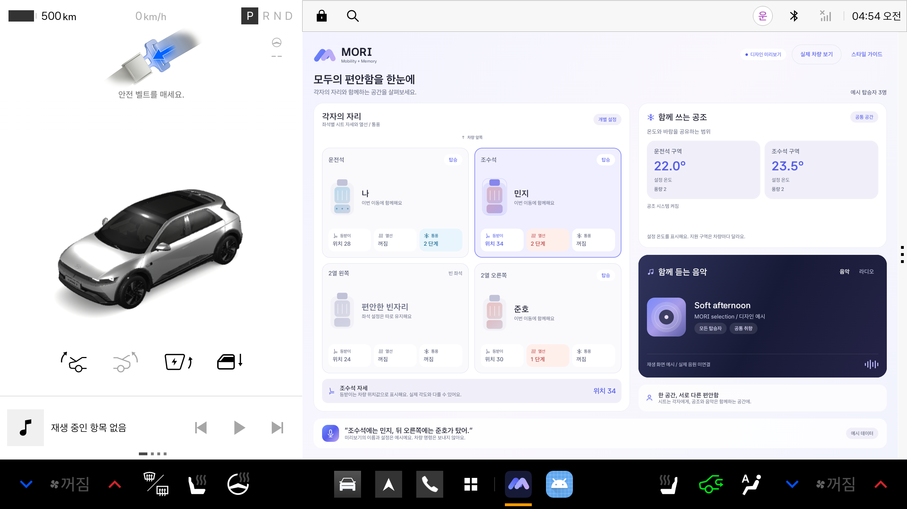

# MORI

음성으로 동승자와 좌석을 알려주면, 저장된 선호와 이번 이동의 요청을 조율해 공조와 함께 들을 음악을 준비하는 Pleos 기반 카 컨시어지 졸업 프로젝트입니다.

## 현재 구현 상태

- 로고 초안 기반 블루/라벤더 디자인 시스템과 앱 내 스타일 가이드
- 4개 좌석의 등받이 위치, 열선, 통풍을 개별 카드로 시각화
- 공조 구역과 음악/라디오를 공통 공간으로 분리
- 지원 범위 확인 후 좌석과 공조 상태를 자동 조회
- 실제 차량 데이터와 명시적 디자인 미리보기 분리

음성 대화, 프로필 저장, 실제 차량용 공조 제어와 음악 재생은 다음 구현 범위입니다. 개발용 앱의 차량 테스트 패널에서는 공식 에뮬레이터에 시트 자세와 공조 명령을 보낼 수 있습니다. 디자인 미리보기의 예시 설정은 전송하지 않습니다.

에뮬레이터 제어와 신호 연결: [제어 사용법과 지원 범위](docs/EMULATOR_CONTROLS.md)

디자인 기준: [MORI 디자인 시스템](docs/DESIGN_SYSTEM.md)



[실시간 제어 반영 화면](docs/images/control-sync.png) / [앱 내 스타일 가이드](docs/images/style-guide.png)

## 처음 실행하기

1. Android Studio를 실행하고 **Open**을 선택합니다.
2. 이 저장소 안의 **android 폴더**를 엽니다.
3. Gradle JDK를 **Java 17**로 선택하고 초기 동기화가 끝날 때까지 기다립니다.
4. Device Manager에서 **Pleos Connect v2.1.0**을 켭니다.
5. 실행 대상에 Pleos를 선택하고 위쪽의 **▶ Run**을 누릅니다.
6. 좌석과 공조 상태가 자동으로 갱신됩니다. **디자인 미리보기**에서 예시 화면을, **스타일 가이드**에서 공통 디자인을 확인합니다.

컴퓨터에서 사용할 폴더: `/Users/saeuncheon/Desktop/26-2 CCP II/MORI/android`

상세 안내: [개발 시작하기](docs/GETTING_STARTED.md), [초기 검증 결과](docs/VALIDATION.md)

## 폴더 구성

```text
android/     Kotlin 차량 앱. Android Studio에서 여는 폴더
server/      향후 음성 AI 연결 서버를 위한 공간
docs/        실행 방법, 구성과 다음 개발 계획
.github/     GitHub 자동 빌드 설정
```

## 개발 환경

| 항목 | 기준 |
| --- | --- |
| Java | 17 |
| Gradle | 8.10.2, Wrapper 포함 |
| Android Gradle Plugin | 8.8.2 |
| Kotlin | 2.0.0 |
| Android | compile SDK 35, target SDK 34, minimum SDK 28 |
| Pleos Emulator | API 34, 2.1.0 |
| Vehicle SDK | 2.3.2 |
| NaviHelper | 3.0.5 |

```bash
cd android
./gradlew :app:assembleDebug :app:lintDebug
```

macOS 터미널에서 Java 버전 오류가 나면 먼저 `export JAVA_HOME=$(/usr/libexec/java_home -v 17)`을 실행합니다. API 키는 앱과 Git 저장소에 포함하지 않습니다. 현재 초기 앱 실행에는 외부 AI 계정이나 API 키가 필요하지 않습니다.

## 다음 개발

[구현 계획](docs/ROADMAP.md), [구조와 연동 원칙](docs/ARCHITECTURE.md)을 참고합니다.

GitHub Actions에는 빌드와 Android Lint 검사를 설정했습니다. 실제 차량 API 권한과 에뮬레이터 동작은 로컬에서 별도로 검증합니다.
