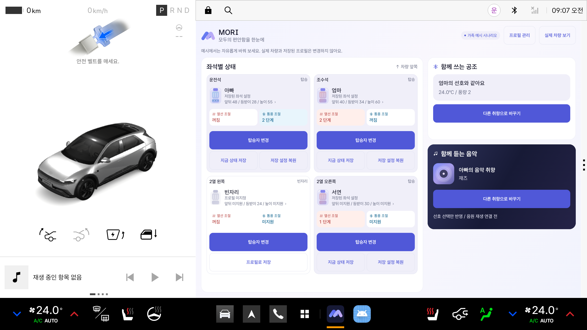

# MORI

음성으로 동승자와 좌석을 알려주면, 저장된 선호와 이번 이동의 요청을 조율해 공조와 함께 들을 음악을 준비하는 Pleos 기반 카 컨시어지 졸업 프로젝트입니다.

## 현재 구현 상태

- **한 화면의 차량 상태**: 좌석별 자세/열선/통풍, 공유 공조와 미디어 취향을 한눈에 표시
- **탑승자 변경**: 모든 좌석에서 기존 프로필 선택, 새 프로필 생성, 게스트 선택
- **저장과 복원**: 게스트의 현재 좌석 설정을 새 프로필 또는 기존 프로필로 저장. 연결된 프로필에 덮어쓰기와 저장 설정 복원
- **숨겨진 프로필 관리**: 상단 버튼으로 여는 설정창에서 생성, 수정, 삭제
- **공통 프로필 목록**: 탑승 중인 사람 우선 정렬, 가족/친구/동료/기타/미지정 관계 필터
- **가족 예시 시나리오**: 아빠/엄마/자녀의 선호와 비탑승 프로필을 포함. 모든 변경은 예시 세션 안에서만 유지
- **실시간 제어**: 좌석 조절창, 공조 직접 조절과 프로필 선호 적용. 실제 차량용 제어는 별도 검증 범위

새 앱 실행 시 인식된 동승자는 우선 게스트로 표시합니다. 이름은 사용자가 명시적으로 프로필을 연결한 뒤 표시하며 좌석 연결은 앱 실행 중에만 유지합니다. 기기에 저장된 프로필을 탑승 여부만으로 자동 배정하지 않습니다.

음성 대화와 음원 재생은 후속 단계입니다. 현재 음악/라디오는 장르 또는 채널 선호 선택까지만 반영합니다.



[프로필 선택 화면](docs/images/unified-occupant.png) / [관계 필터](docs/images/unified-profile-filter.png) / [사용법과 UX 검토](docs/PROFILE_DASHBOARD.md)

## 처음 실행하기

1. Android Studio를 실행하고 **Open**을 선택합니다.
2. 이 저장소 안의 **android 폴더**를 엽니다.
3. Gradle JDK를 **Java 17**로 선택하고 초기 동기화가 끝날 때까지 기다립니다.
4. Device Manager에서 **Pleos Connect v2.1.0**을 켭니다.
5. 실행 대상에 Pleos를 선택하고 위쪽의 **▶ Run**을 누릅니다.
6. 각 좌석의 **탑승자 변경**에서 프로필을 지정합니다. **프로필 관리**로 설정창을 열고, **예시 시나리오**에서 가족의 선호를 바꿔볼 수 있습니다.

컴퓨터에서 사용할 폴더: `/Users/saeuncheon/Desktop/26-2 CCP II/MORI/android`

상세 안내: [개발 시작하기](docs/GETTING_STARTED.md), [초기 검증 결과](docs/VALIDATION.md)

## 폴더 구성

```text
android/     Kotlin 차량 앱. Android Studio에서 여는 폴더
server/      향후 음성 AI 연결 서버를 위한 공간
docs/        실행 방법, 구성과 다음 개발 계획
.github/     GitHub 자동 빌드 설정
```

## 개발 환경

| 항목 | 기준 |
| --- | --- |
| Java | 17 |
| Gradle | 8.10.2, Wrapper 포함 |
| Android Gradle Plugin | 8.8.2 |
| Kotlin | 2.0.0 |
| Android | compile SDK 35, target SDK 34, minimum SDK 28 |
| Pleos Emulator | API 34, 2.1.0 |
| Vehicle SDK | 2.3.2 |
| NaviHelper | 3.0.5 |

```bash
cd android
./gradlew :app:assembleDebug :app:lintDebug
```

macOS 터미널에서 Java 버전 오류가 나면 먼저 `export JAVA_HOME=$(/usr/libexec/java_home -v 17)`을 실행합니다. API 키는 앱과 Git 저장소에 포함하지 않습니다. 현재 초기 앱 실행에는 외부 AI 계정이나 API 키가 필요하지 않습니다.

## 다음 개발

[구현 계획](docs/ROADMAP.md), [구조와 연동 원칙](docs/ARCHITECTURE.md)을 참고합니다.

GitHub Actions에는 빌드와 Android Lint 검사를 설정했습니다. 실제 차량 API 권한과 에뮬레이터 동작은 로컬에서 별도로 검증합니다.
